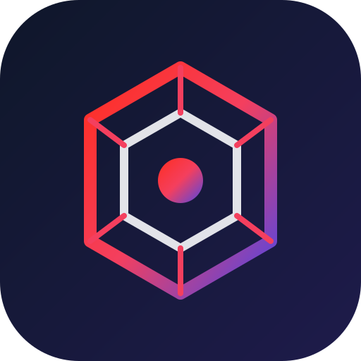

<p align="center">
  
</p>

<h1 align="center">Beautiful PHP & Laravel</h1>

<p align="center">
  <strong>Production-grade modern PHP (8.3 - 8.5) and Laravel 13.x distilled into Agent Skills.</strong>
</p>

<p align="center">
  <a href="https://github.com/saifulabidin/BeatifulPHPLaravel/actions/workflows/ci.yml"></a>
  <a href="https://github.com/saifulabidin/BeatifulPHPLaravel/blob/main/LICENSE"></a>
  <a href="https://php.net"></a>
  <a href="https://laravel.com"></a>
  <a href="https://agentskills.io"></a>
  <a href="https://pestphp.com"></a>
  <a href="https://github.com/larastan/larastan"></a>
</p>

---

## Overview

**Beautiful PHP & Laravel** is a production-grade suite of three standard [Agent Skills](https://agentskills.io) and drop-in tooling configurations designed to prevent generic AI code generation from producing monolithic controllers, vulnerable mass assignments, N+1 query cascades, and fragile framework calls.

When installed, AI coding agents write, review, port, and refactor code strictly according to modern PHP 8.3 - 8.5 standards and Laravel 13 enterprise conventions.

- **`laravel-best-practices`**: Loaded whenever an agent writes or modifies PHP or Laravel code. Steers the agent toward clean architecture, thin controllers, single-responsibility Action classes, Livewire 3/4 component hygiene, typed DTOs, Eloquent eager loading, and Pest tests.
- **`laravel-review`**: Audits existing code, pull requests, or Git diffs. Delivers prioritized engineering reports citing violated standards and concrete code remedies.
- **`laravel-port`**: Guides migrations from legacy procedural PHP, Express.js/Node, Python (Django/FastAPI), or Ruby on Rails into idiomatic Laravel 13 with identical observable behavior, porting tests first into Pest.
- **`lints/`**: Drop-in configuration presets for Laravel Pint (`pint.json`), Larastan level 8 (`phpstan.neon`), and Rector (`rector.php`).

Compatible with **Antigravity (CLI & IDE)**, **Claude Code**, **OpenAI Codex**, **Cursor**, **Windsurf**, **Gemini CLI**, **GitHub Copilot**, and any agent conforming to the Agent Skills open standard.

---

## Architectural Lifecycle

Every state-changing request adheres to a unidirectional, decoupled flow:

```text
HTTP Request / Livewire Event
  │
  ▼
[FormRequest / Livewire Form] ──► Input boundary validation & Policy authorization
  │
  ▼
[Controller / Component]     ──► Router only (zero queries, zero business logic)
  │
  ▼
[Domain Action Class]        ──► Single execute() method, DB::transaction()
  │
  ├──► [DTO (readonly)]      ──► Strongly-typed immutable data transport
  ├──► [Repository / Model]  ──► Eager-loaded Eloquent queries (no N+1)
  └──► [Domain Event]        ──► Dispatched for background side effects & jobs
```

---

## What It Changes (Real-World Comparison)

### Without the Skill (Typical AI Generation)
An unconstrained AI agent writing an order endpoint produces a bloated controller with raw validation, unparameterized logic, queries inside loops (N+1), fragile named arguments on framework methods, and unhandled side effects:

```php
// app/Http/Controllers/OrderController.php
class OrderController extends Controller
{
    public function store(Request $request)
    {
        // Antipattern: Inline validation & fragile named argument on framework method
        $request->validate(rules: ['items' => 'required']);

        // Antipattern: Direct DB write without transaction
        $order = Order::create(['user_id' => auth()->id()]);

        // Antipattern: N+1 query executed inside loop
        foreach ($request->items as $item) {
            $product = Product::find($item['id']);
            $order->items()->create([
                'product_id' => $product->id,
                'price' => $product->price,
            ]);
        }

        // Antipattern: Synchronous third-party I/O blocking request worker
        Mail::to(auth()->user()->email)->send(new OrderReceipt($order));

        return response()->json($order);
    }
}
```

### With the Skill (Idiomatic Modern Architecture)
With the skill active, the agent automatically decomposes the request into distinct, testable layers:

```php
// 1. Boundary Protection (app/Http/Requests/StoreOrderRequest.php)
final class StoreOrderRequest extends FormRequest
{
    public function authorize(): bool
    {
        return $this->user()->can('create', Order::class);
    }

    public function rules(): array
    {
        return [
            'items' => ['required', 'array', 'min:1'],
            'items.*.product_id' => ['required', 'integer', 'exists:products,id'],
            'items.*.quantity' => ['required', 'integer', 'min:1'],
        ];
    }
}

// 2. Thin Controller (app/Http/Controllers/OrderController.php)
final class OrderController extends Controller
{
    public function store(
        StoreOrderRequest $request,
        CreateOrderAction $action,
    ): JsonResponse {
        $order = $action->execute(
            $request->user(),
            CreateOrderData::fromRequest($request),
        );

        return (new OrderResource($order->loadMissing('items.product')))
            ->response()
            ->setStatusCode(Response::HTTP_CREATED);
    }
}

// 3. Single-Responsibility Action (app/Actions/Order/CreateOrderAction.php)
final class CreateOrderAction
{
    public function execute(User $user, CreateOrderData $data): Order
    {
        return DB::transaction(function () use ($user, $data) {
            $order = Order::create(['user_id' => $user->id]);

            // Efficient batch loading preventing N+1
            $products = Product::whereIn('id', $data->productIds())->get()->keyBy('id');

            foreach ($data->items as $item) {
                $product = $products->get($item->productId);
                $order->items()->create([
                    'product_id' => $product->id,
                    'price' => $product->price,
                    'quantity' => $item->quantity,
                ]);
            }

            // Asynchronous event dispatching
            OrderCreatedEvent::dispatch($order);

            return $order;
        });
    }
}
```

---

## Comprehensive Reference Compendium

The skill bundles 8 in-depth engineering digests under `skills/laravel-best-practices/references/`:

| Reference Guide | Summary & Focus Areas |
|---|---|
| **[Clean Architecture](skills/laravel-best-practices/references/laravel-architecture.md)** | Unidirectional request lifecycle, FormRequest boundaries, Action patterns, DTOs, domain exceptions, and Architecture Decision Records (ADRs). |
| **[Eloquent & N+1 Performance](skills/laravel-best-practices/references/eloquent-performance-n1.md)** | Eager loading with `with()`, `Model::preventLazyLoading`, accessor traps, subquery `addSelect()`, `whereIn + pluck` vs `whereHas`, and batch processing. |
| **[Livewire & TALL Stack](skills/laravel-best-practices/references/livewire-and-tall-stack.md)** | State hardening with `#[Locked]`, Form Objects (`Livewire\Form`), computed memoization `#[Computed]`, deferred loading `#[Lazy]`, and zero-query Blade templates. |
| **[Naming Conventions Matrix](skills/laravel-best-practices/references/laravel-naming-conventions.md)** | Canonical matrix of Laravel community conventions (models, plural tables, alphabetical pivot tables, relationships, actions, routes, enums). |
| **[Caching, Resilience & Queues](skills/laravel-best-practices/references/caching-and-resilience.md)** | Atomic `Cache::remember()`, stale-while-revalidate `Cache::flexible()`, distributed `Cache::lock()`, HTTP timeouts `Http::timeout(5)`, and queue idempotency. |
| **[Modern PHP (8.3 - 8.5)](skills/laravel-best-practices/references/php-modern-features.md)** | Strict typing, readonly classes, backed Enums, typed constants, `json_validate()`, property hooks, asymmetric visibility, and SemVer named argument rules. |
| **[Security Engineering](skills/laravel-best-practices/references/laravel-security.md)** | OWASP Top 10 mitigation: IDOR prevention, parameterized queries, strict `$fillable` mass assignment, Blade escaping, and secrets abstraction. |
| **[Pest & Architecture Testing](skills/laravel-best-practices/references/testing-pest-guidelines.md)** | Pest v3 testing patterns, Livewire component tests, and architectural assertions (`arch()`) verifying class boundaries and strict typing. |

---

## Drop-in CI Tooling Configurations

Production-ready linter and static analysis configurations are included in `lints/`:

- **[pint.json](lints/pint.json)**: Laravel Pint configuration enforcing PSR-12, `declare_strict_types`, ordered imports, and clean formatting.
- **[phpstan.neon](lints/phpstan.neon)**: Larastan configuration configured at **Level 8** with strict parameter, return type, and callable checks.
- **[rector.php](lints/rector.php)**: Automated refactoring rules targeting PHP 8.3/8.4 language levels, early returns, and dead code elimination.

### GitHub Actions Integration Example

```yaml
# .github/workflows/quality.yml
name: Code Quality & Tests

on: [push, pull_request]

jobs:
  tests:
    runs-on: ubuntu-latest
    steps:
      - uses: actions/checkout@v4
      - uses: shivammathur/setup-php@v2
        with:
          php-version: '8.3'
          coverage: none
      - run: composer install --prefer-dist --no-interaction
      - run: vendor/bin/pint --test
      - run: vendor/bin/phpstan analyse
      - run: vendor/bin/pest
```

---

## Installation

### Any AI Agent (One Command via Skills CLI)
The standard [skills](https://github.com/vercel-labs/skills) installer installs the suite across agents:

```bash
npx skills add saifulabidin/BeatifulPHPLaravel
```

### Antigravity (CLI & IDE)
Install as a native plugin:
```bash
agy plugin install saifulabidin/BeatifulPHPLaravel
```
Or register the local repository globally:
```bash
ln -s /path/to/BeatifulPHPLaravel ~/.gemini/config/plugins/beautiful-php-laravel
agy plugin enable beautiful-php-laravel
```

### Claude Code
Install as a plugin:
```bash
claude plugin install saifulabidin/BeatifulPHPLaravel
```

### Cursor, Windsurf, or GitHub Copilot
Clone or link the `skills/` directory into your workspace's `.agents/skills/` or `.cursor/skills/` directory:
```bash
mkdir -p .agents/skills
cp -r /path/to/BeatifulPHPLaravel/skills/* .agents/skills/
```

---

## Verification & Testing

Every skill, frontmatter, and code file in this repository is tested automatically:

```bash
# Validate frontmatter, byte budgets (<24KB body), and line limits (<300 lines)
python3 scripts/check-skills.py

# Run unit test suite
python3 -m unittest discover -s tests

# Validate Antigravity plugin manifest
agy plugin validate .
```

---

## Acknowledgments & Credits

This project is directly inspired by and models its agent skill architecture on **[Beautiful Rust](https://github.com/morganlinton/BeautifulRust)** by [Morgan Linton](https://github.com/morganlinton), which established the benchmark for multi-agent skill distillation, reference digests, and drop-in linter configurations.

---

## Author & License

Created and maintained by **[Saiful Abidin](https://github.com/saifulabidin)**.

Released under the **[MIT License](LICENSE)**.
